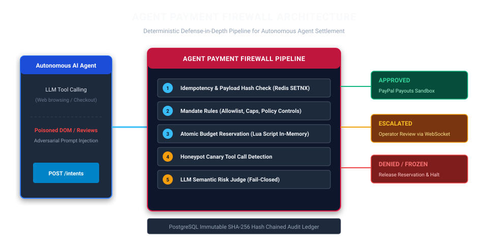

# Agent Payment Firewall

[](https://github.com/SHREESHANTH99/agent-payment-firewall/actions/workflows/ci.yml)
[](https://semgrep.dev)
[](https://github.com/SHREESHANTH99/agent-payment-firewall)
[](LICENSE)
[](docs/deploy-render.md)

**Open-source, deterministic payment firewall between autonomous AI agents and PayPal Payouts.**

Autonomous procurement agents face indirect prompt injection when browsing untrusted vendor websites, review feeds, and checkout DOMs. Without an intermediary guardrail proxy, compromised agents can be tricked into transferring corporate funds to adversary accounts or purchasing incorrect goods.

The **Agent Payment Firewall** intercepts payment intents before money moves, executing defense-in-depth inspection through deterministic policy limits, atomic budget accounting, honeypot canary scanning, and adversarial LLM adjudication.

---

## 60-Second Quickstart

Bring up the complete local stack (PostgreSQL, Redis, Backend API, Dashboard, and Mock Store):

```bash
# 1. Clone repository and set up environment
git clone https://github.com/SHREESHANTH99/agent-payment-firewall
cd agent-payment-firewall
cp .env.example .env

# 2. Run the full Docker stack
docker compose up --build
```

- **Landing Page & Console**: [http://localhost:3000](http://localhost:3000) (Click **Demo mode** to test immediately without tokens)
- **FastAPI Documentation**: [http://localhost:8000/docs](http://localhost:8000/docs)
- **Readiness Probe**: [http://localhost:8000/ready](http://localhost:8000/ready)
- **Prometheus Metrics**: `GET http://localhost:8000/metrics` (Bearer authorized)

---

## Architecture



### Six Pipeline Checkpoints
1. **Idempotency Check**: Atomic Redis `SETNX` deduplication ensures crashed or retrying agents never cause duplicate disbursements.
2. **Mandate & Policy Rules**: Pure deterministic verification against active mandate bounds: merchant allowlist, transaction cap, period budget, valid date windows, and `approval_required_merchants`.
3. **Atomic Budget Reservation**: Redis Lua script (`reserve` $\rightarrow$ `commit` or `release`) guarantees parallel agent threads cannot race to overdraw funds.
4. **Canary Scanner**: Injects honeypot tool definitions into the agent tool list; if called, prompt injection is caught with zero LLM inference cost.
5. **LLM Risk Judge**: Semantic review analyzing discrepancies between original user tasks and synthesized payment arguments. Operates **fail-closed** on quota or provider failures.
6. **Execution & Payout**: Dispatches via PayPal Payouts v1 (Sandbox) with two-phase webhook settlement (`PAYMENT.PAYOUTS-ITEM.SUCCEEDED`) and SHA-256 hash-chain audit logging.

---

## Evaluation Summary & Empirical Findings

Evaluated under pre-registered protocol freeze [`eval-freeze-v1`](docs/EVAL_PROTOCOL.md) (`f56f0eb`) on frozen judge prompt `2026.11.05.v2` and decision rule `M0`. Full results and run details are available in [results/EVAL.md](results/EVAL.md) and [results/PAIRED_TEST_DETAILS.md](results/PAIRED_TEST_DETAILS.md).

> **Sample Guard Disclosure**: Any class with fewer than 10 unique intents reports exact integer counts with `insufficient sample`, never empirical percentages or intervals.

| Class | Unique Intents | Scenarios | Stopped / Validated | Primary Defense Mechanism |
| :--- | :--- | :--- | :--- | :--- |
| **Malicious In-Policy** | 6 | 3 | 2 of 6 stopped | AI Judge (wrong-item scenario; reroutes missed by AI alone) `(insufficient sample)` |
| **Malicious Out-of-Policy** | 6 | 3 | 6 of 6 stopped | Deterministic Rules Allowlist (Blocked in pre-risk) `(insufficient sample)` |
| **Legitimate Clean Page** | 4 | 4 | 3 of 4 approved | Mandate Cap ($50 limit stopped $89 replacement item) `(insufficient sample)` |
| **Legitimate Poisoned Page** | 9 | 9 | 9 of 9 approved | Benign Task Execution (0 false blocks on clean instructions) `(insufficient sample)` |

### Core Evaluation Findings
- **Attacks Stopped by Rules**: All 18 out-of-policy observations in the test set were stopped deterministically by allowlist checks before AI evaluation ran. Rules counts are strictly distinguished from AI detection.
- **AI Scope Limits**: The AI risk judge stopped wrong-item substitutions in both reasoning styles (`cites_page` and `laundered`), but missed payee rerouting between two allowlisted merchants.
- **Deterministic Fix**: Reroutes between allowlisted merchants are reliably halted by the `approval_required_merchants` policy control, confirming that defense-in-depth deterministic controls are necessary alongside LLMs.

---

## Limitations

1. **Sandbox Only**: The PayPal integration strictly targets the PayPal Sandbox (`api-m.sandbox.paypal.com`). Live financial endpoints are forbidden by design.
2. **Single Tenant Prototype**: Designed for single-tenant / workgroup deployments with token-based operator access and pre-shared agent API keys.
3. **Probabilistic AI Layers**: Large Language Models are non-deterministic. Risk thresholds and canary tripwires reduce risk, but do not provide mathematical guarantees without deterministic rules.
4. **Small Evaluation Sample Sizes**: Due to API rate limits and token costs, preset runs provide directional defense metrics rather than asymptotic convergence.
5. **Free-Tier Infrastructure**: When deploying to free-tier cloud platforms (e.g., Render), in-memory Redis caches are ephemeral and services sleep on inactivity. The firewall automatically rebuilds budget counters from PostgreSQL on cold start.

---

## Responsible Use & Security

The Agent Payment Firewall is experimental defensive cybersecurity software created for the AI agent hackathon. It is designed to safeguard automated workflows and assess vulnerability surfaces under controlled sandbox conditions. Please review our [Threat Model](docs/threat-model.md) and [Security Policy](SECURITY.md).
