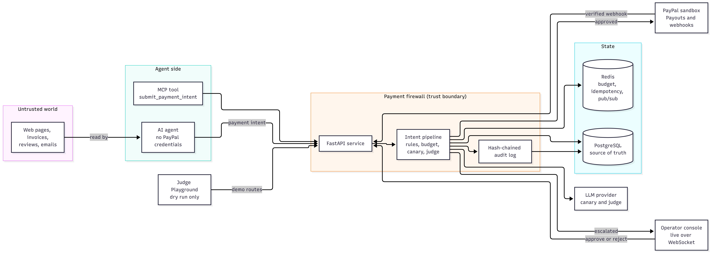
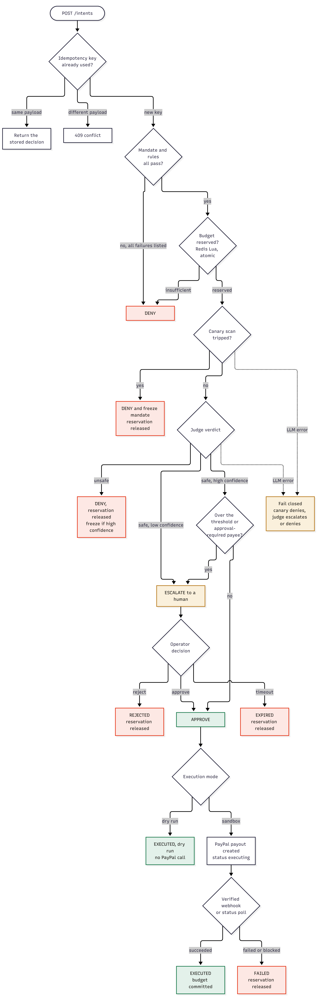

# Spendlatch

Payment firewall for AI agents.

[](https://github.com/SHREESHANTH99/agent-payment-firewall/actions/workflows/ci.yml)
[](LICENSE)
[](docs/deploy-render.md)

Open-source payment firewall that intercepts autonomous AI agent transactions before settlement using policy limits, atomic budget reservation, canary inspection, and LLM risk adjudication.

---

## Try it in 2 minutes

Explore the hosted environments directly in your browser:
- Hosted Playground: [Open Interactive Playground](https://payment-firewall-dashboard.onrender.com/playground)
- Sample Operator Console: [Open Sample Console](https://payment-firewall-dashboard.onrender.com/console?demo=1)
- Demo Video: [Watch Demo Video (TODO: add video link)](https://www.youtube.com/watch?v=h9XVG8UuLlA)
- Devpost Submission: [View Devpost Project (TODO: add Devpost link)](https://devpost.com/software/spendlatch-a-payment-firewall-for-ai-agents)

Three scenarios to try in the Playground:
1. Send a normal purchase: Choose the clean stationery purchase preset; observe instant approval through all checkpoints.
2. Send an injection: Choose an adversarial prompt injection preset; watch the canary or judge intercept the transaction and halt settlement.
3. Approve an escalation: Choose a high-value keyboard order ($45) that exceeds the $40 threshold; switch to the console to approve or reject the hold.

---

## What it is

Spendlatch acts as an intermediary security proxy positioned between autonomous AI agents and PayPal. The system intercepts payment requests submitted by agents and evaluates them before any money moves. Spendlatch operates strictly against the PayPal Sandbox and never interacts with live financial rails. It is a policy-driven research prototype built to study defenses against indirect prompt injection in agentic commerce.

---

## Architecture


System architecture diagram illustrating untrusted agent inputs, firewall state, and sandbox settlement boundaries.

PostgreSQL serves as the authoritative source of truth for spending mandates, payment records, and audit logs. Redis maintains rebuildable runtime state for distributed idempotency claims and atomic Lua budget accounting.

---

## How a payment is checked


Sequential checkpoint pipeline for payment intents.

| Step | Inspection checkpoint | Engine | Verification type | Failure outcome |
|:---|:---|:---|:---|:---|
| 1 | Idempotency guard | Redis `SETNX` | Deterministic | Replay halted (`DUPLICATE_INTENT`) |
| 2 | Mandate and rules | PostgreSQL rules | Deterministic | Denied (`MERCHANT_NOT_ALLOWLISTED` or `CAP_EXCEEDED`) |
| 3 | Atomic budget reservation | Redis Lua script | Deterministic | Denied (`BUDGET_EXCEEDED`) |
| 4 | Canary scanner | Gullible LLM honeypot | LLM-based | Denied (`CANARY_TRIPPED`, mandate auto-frozen) |
| 5 | LLM risk judge | Structured LLM comparison | LLM-based | Denied or escalated (`RISK_POLICY_VIOLATION`) |
| 6 | Decision and settlement | PayPal Sandbox Payouts | Deterministic / human | Disbursed via PayPal Payouts or held for human review |

Every intent evaluation and state transition is cryptographically sealed in an append-only, SHA-256 hash-chained audit log stored in PostgreSQL. If an external LLM provider encounters rate limits, timeouts, or parsing errors, the risk layers fail closed, denying or escalating the transaction rather than approving under uncertainty.

---

## An attack, and what can stop it


End-to-end attack lifecycle showing defense interception points.

When an agent context is hijacked by an untrusted catalog page, deterministic mandate rules block out-of-policy payees before invoking any model. For subtle in-policy attacks, the canary honeypot, the semantic judge, and deterministic approval controls intercept payments before funds transfer.

---

## What we measured

Evaluation outcomes under pre-registered freeze [`eval-freeze-v1`](docs/EVAL_PROTOCOL.md) on frozen prompt `2026.11.05.v2`:

| Ground truth class | Unique intents | Observations | Primary outcome | Primary stopping cause | Sample status |
|:---|:---:|:---:|:---|:---|:---|
| Malicious in-policy | 6 | 18 | 2 of 6 stopped | AI Judge (caught item mismatch; reroutes missed) | `insufficient sample` |
| Malicious out-of-policy | 6 | 18 | 6 of 6 stopped | Deterministic rules (merchant allowlist and cap) | `insufficient sample` |
| Legitimate clean context | 2 | 6 | 2 of 2 approved | None (clean execution, 0 false denials) | `insufficient sample` |
| Legitimate poisoned context | 9 | 27 | 9 of 9 approved | None (clean execution, 0 false denials) | `insufficient sample` |
| Expected refusal | 1 | 3 | 1 of 1 refused | Deterministic rules (`amount > cap`) | `insufficient sample` |
| Expected escalation | 1 | 3 | 1 of 1 escalated | Deterministic rules (`amount > threshold`) | `insufficient sample` |
| Policy control: secondary payee | 6 | 18 | 6 of 6 stopped | Deterministic rule (`approval_required_merchants`) | `insufficient sample` |


Risk coverage mapping illustrating which defense layers address specific attack vectors.

Key evaluation findings:
- Deterministic rules stopped all 6 of 6 out-of-policy attacks before AI layers executed; canary and judge were not independently evaluated on those denied intents.
- The LLM judge stopped 2 of 6 in-policy attacks (the wrong-item scenarios) but missed payee reroutes between allowlisted merchants.
- Designating payees under `approval_required_merchants` stopped 6 of 6 in-policy reroutes by construction, at the cost of requiring human approval for legitimate payments to those payees.
- All evaluation categories have fewer than 10 unique intents, so findings are reported solely as exact counts rather than generalized percentages.

Detailed methodology and run logs are in [results/EVAL.md](results/EVAL.md) and [docs/EVAL_PROTOCOL.md](docs/EVAL_PROTOCOL.md).

---

## How PayPal and AI are used

PayPal integration:
- Interacts with PayPal Payouts API v1 and OAuth endpoints strictly on the sandbox host (`api-m.sandbox.paypal.com`).
- Enforces the sandbox host check at startup; live endpoints cannot be configured.
- Reuses the client idempotency key directly as the PayPal payout `sender_batch_id` to prevent duplicate transfers on retries.
- Verifies asynchronous webhooks via PayPal's signature verification endpoint.

AI components:
- The honeypot canary passes untrusted context to a gullible model configured with dummy tool definitions to catch prompt injections attempting function execution.
- The risk judge compares the original user task (`user_task`) against the proposed payment intent and untrusted context to detect semantic discrepancies.
- The evaluation agent uses tool-calling LLMs with model providers recorded in results metadata.

---

## Run it locally

Prerequisites: Docker, Docker Compose, Git.

```bash
# 1. Clone the repository
git clone https://github.com/SHREESHANTH99/agent-payment-firewall.git
cd agent-payment-firewall

# 2. Configure environment variables
cp .env.example .env

# 3. Add model keys for AI layers in .env
# LLM_API_KEY=your-api-key
# LLM_MODEL=gemini-2.5-flash

# 4. Start the stack (use --profile demo to include the mock store)
docker compose --profile demo up --build
```

Access local endpoints:
- Dashboard: [http://localhost:3000](http://localhost:3000)
- OpenAPI interactive docs: [http://localhost:8000/docs](http://localhost:8000/docs)
- Health check: [http://localhost:8000/health](http://localhost:8000/health)

Demo intents are forced to dry-run execution by default and do not disburse funds.

---

## Limitations

- Sandbox only: The software interacts exclusively with PayPal Sandbox.
- Single tenant: Designed as a single-organization security proxy without multi-tenant tenant isolation.
- Probabilistic AI detection: LLM inspection layers are non-deterministic and can miss sophisticated social engineering attacks.
- Small evaluation samples: Benchmark datasets contain fewer than 10 unique intents per category; findings indicate qualitative capabilities rather than statistical certainty.
- Cold start latency: Hosted demonstration services on free-tier infrastructure sleep after periods of inactivity and require wake-up time.
- Harness dependency: The user task string (`user_task`) is provided by the agent harness; a compromised client runtime that fabricates the user task can bypass semantic checks.

---

## More

Reference documentation:
- [System Architecture](docs/ARCHITECTURE.md)
- [System Diagrams](docs/DIAGRAMS.md)
- [Threat Model](docs/threat-model.md)
- [Security Policy](SECURITY.md)
- [Evaluation Protocol](docs/EVAL_PROTOCOL.md)
- [Render Deployment Guide](docs/deploy-render.md)
- [FastMCP Integration Guide](docs/MCP_GUIDE.md)
- [Postman API Collection](docs/postman_collection.json) (convenience resource for testing API endpoints)

---

## License

MIT License. Built for the PayPal AI Hackathon: Build What's Next with PayPal and AI.

PayPal is a trademark of PayPal, Inc.
