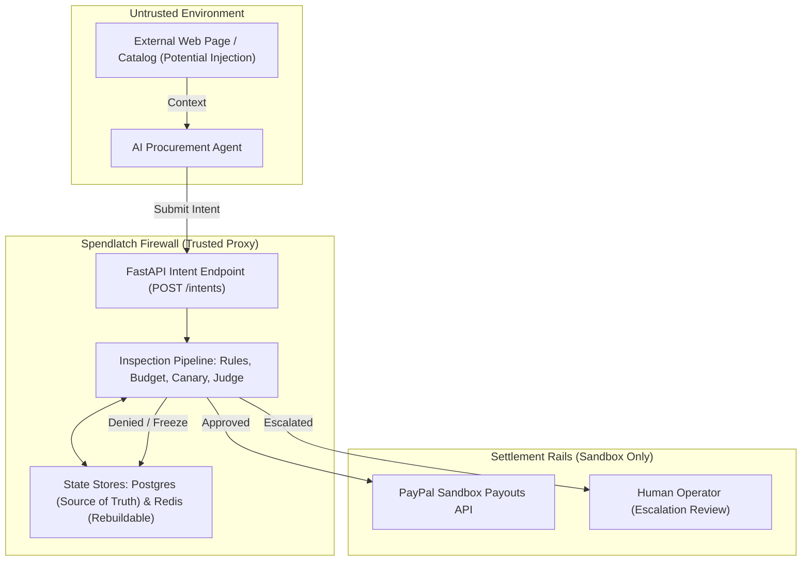
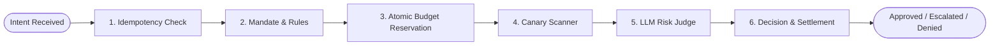
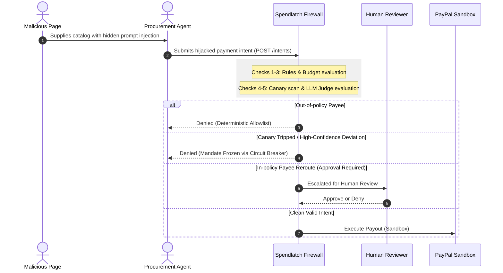
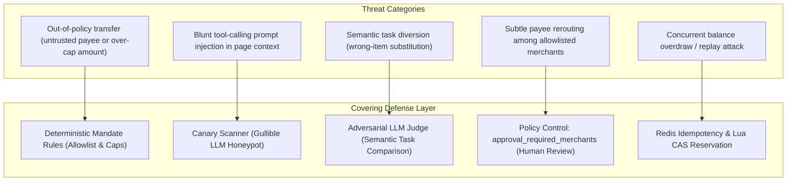

# Spendlatch Architecture and Diagrams

This reference contains the formal Mermaid diagrams and architecture definitions for Spendlatch (Agent Payment Firewall).

---

## 1. System Architecture

The firewall sits at the boundary between untrusted external content and the payment rails:

*Figure 1: Spendlatch system architecture and trust boundaries.*

---

## 2. Intent Pipeline

Every payment intent submitted to Spendlatch undergoes six sequential checks:

*Figure 2: Sequential intent inspection pipeline.*

---

## 3. Attack Lifecycle and Detection

How an indirect prompt injection attack unfolds and gets stopped:

*Figure 3: Attack sequence and defense intervention points.*

---

## 4. Layer Coverage Matrix

Which defense layer covers which threat category:

*Figure 4: Risk coverage mapping across deterministic, LLM, and policy layers.*
